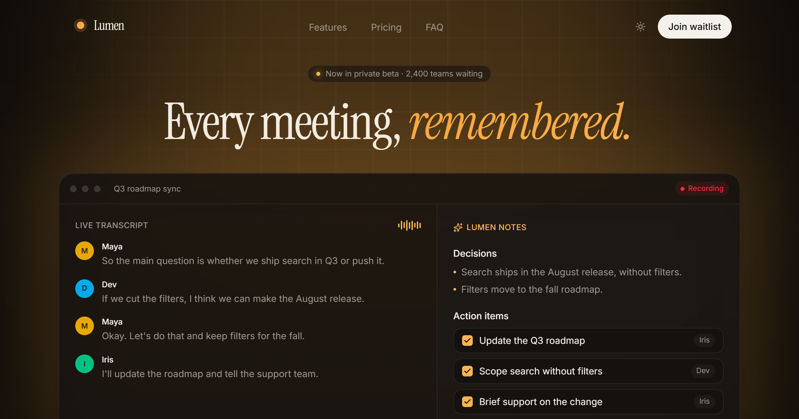
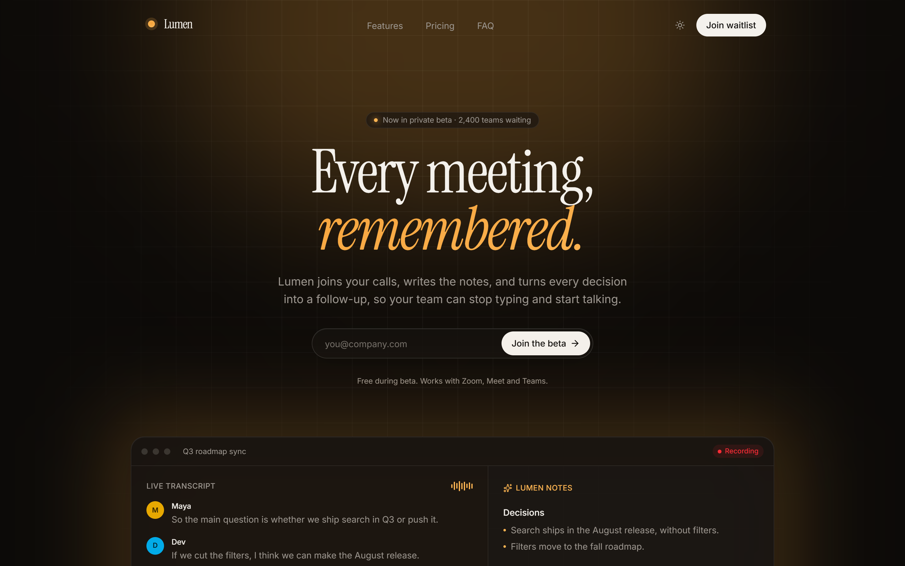
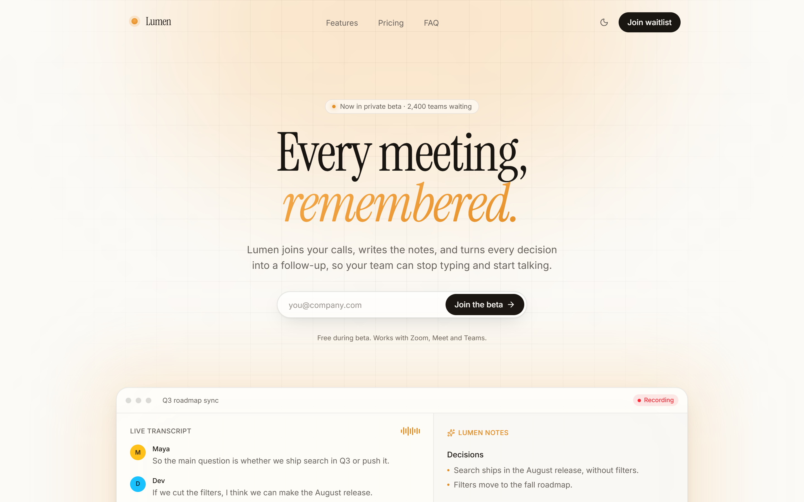
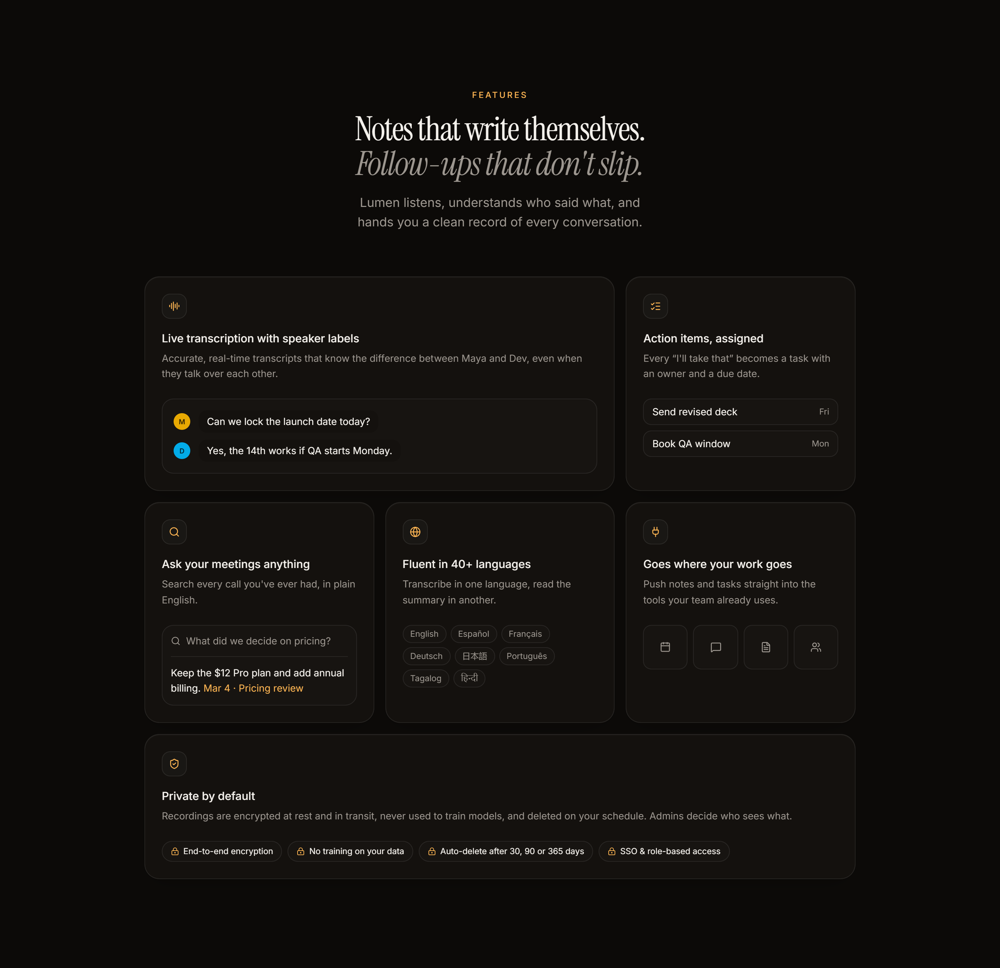
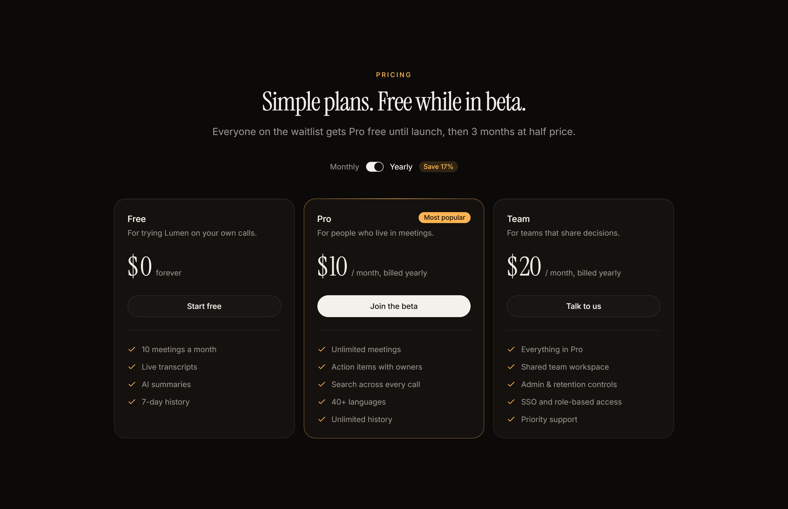
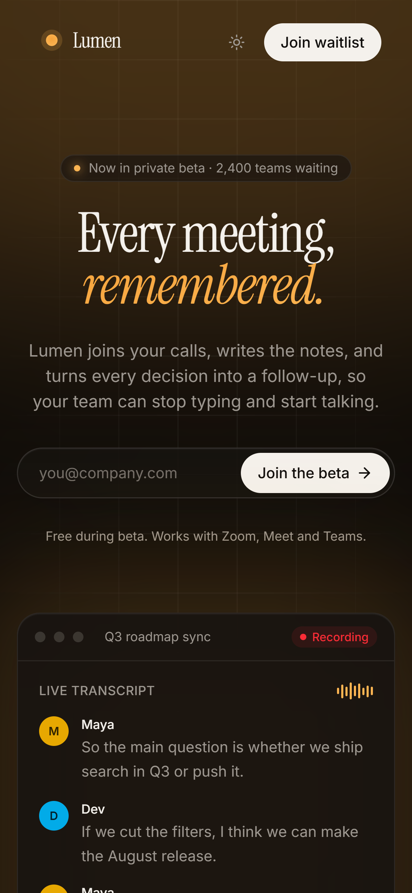
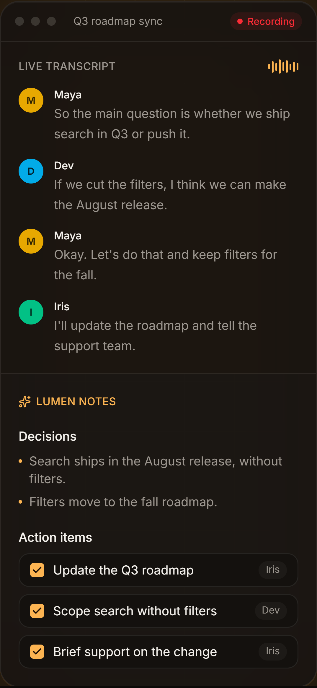
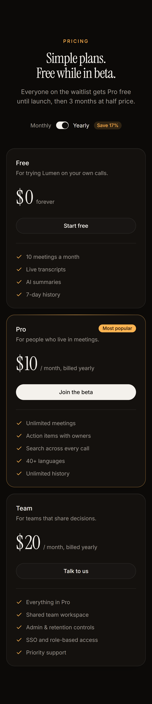

# Lumen: SaaS landing page

**Live site:** https://lumen-sass-landing.vercel.app

A premium landing page for **Lumen**, a made-up AI meeting-notes product. It's a portfolio piece showing the kind of marketing site freelance clients and startups pay for: editorial typography, layered motion, a working waitlist and a dark/light theme.

> Lumen is fictional. Company names, people and testimonials on the page are invented for the demo.



## Screenshots

| Dark | Light |
|---|---|
|  |  |

| Features | Pricing |
|---|---|
|  |  |

| Mobile hero | Mobile mockup | Mobile pricing |
|---|---|---|
|  |  |  |

More in [`docs/screenshots`](docs/screenshots), including full-page captures in both themes. The case study is in [`docs/case-study.md`](docs/case-study.md).

## Features
- **Animated product mockup**: a live transcript fills in line by line, then AI notes and action items check themselves off, on a loop
- **Bento-grid features** with hover glow
- **Testimonials marquee**: two rows moving in opposite directions, pause on hover
- **Pricing** with a monthly/yearly toggle and rolling price animation
- **FAQ accordion** (Base UI via shadcn/ui)
- **Waitlist form** using a Next.js Server Action → Supabase (Postgres + row-level security) → Resend confirmation email, with validation, honeypot spam protection, duplicate handling and a demo mode when no keys are set
- **Dark (default) and light themes**, saved per visitor with no flash on load
- **Social preview image** (Open Graph / Twitter) so shared links show the product
- Smooth scrolling (Lenis), CSS scroll reveals, full `prefers-reduced-motion` support
- Responsive down to 360px, keyboard accessible, skip link, semantic landmarks

## Lighthouse
| | Performance | Accessibility | Best Practices | SEO |
|---|---|---|---|---|
| Desktop | 100 | 100 | 100 | 100 |
| Mobile (simulated slow 4G + 4× CPU) | ~75–85 | 100 | 100 | 100 |

Mobile performance varies run to run. Most of the remaining cost is React/Next.js startup on a throttled CPU.

## Stack ($0)
Next.js 16 (App Router, Server Actions) · TypeScript · Tailwind CSS v4 · shadcn/ui (Base UI) · Motion · Lenis · Supabase free tier · Resend free tier · Vercel Hobby

## Run locally
```bash
npm install
npm run dev
```
Open http://localhost:3000. Without env vars, the waitlist runs in **demo mode**: it logs the email on the server and shows the success state.

## Connect the waitlist (optional, free)
1. Create a project at [supabase.com](https://supabase.com) and run [`supabase/schema.sql`](supabase/schema.sql) in its SQL editor.
2. Create an API key at [resend.com](https://resend.com).
3. Copy `.env.example` to `.env.local` and fill in `SUPABASE_URL`, `SUPABASE_PUBLISHABLE_KEY` (or `SUPABASE_ANON_KEY` on older projects) and `RESEND_API_KEY`.

The public key can only **insert** into the `waitlist` table (row-level security), so it's safe to use from the server.

## Deploy
Push to GitHub, import the repo on [vercel.com](https://vercel.com), and add the same env vars in the project settings. `vercel.json` pins the framework to Next.js.

## Project structure
```
src/
  app/
    actions.ts             # joinWaitlist server action (Supabase + Resend)
    layout.tsx             # fonts, metadata, theme script, smooth scroll
    page.tsx               # section composition
    globals.css            # design tokens (warm ink / warm paper), animations
    opengraph-image.png    # social preview
  components/
    sections/              # hero, features, testimonials, pricing, faq, cta, footer
    product-mockup.tsx     # the animated app window
    waitlist-form.tsx
    reveal.tsx             # CSS scroll reveal + above-the-fold entrance
    ui/                    # shadcn/ui components
supabase/schema.sql
docs/
  thumbnail.png            # 1200×630 card for portfolios (and @2x)
  screenshots/desktop/     # 1440px wide, 2× resolution
  screenshots/mobile/      # 390px wide, 3× resolution
  case-study.md
```

## What I learned
- **Design tokens beat one-off colors.** Defining the palette once in OKLCH (warm ink for dark, warm paper for light) meant the light theme came almost for free: every component reads the same variables.
- **Server Actions + `useActionState` make forms simple.** One server function handles validation, the database insert and the email, and the client gets pending, success and error states without a separate API route.
- **Row-level security lets a public key be safe.** The waitlist key can only insert rows; nobody can read the list with it.
- **Animation has a performance and accessibility cost.** Lighthouse caught that fading text with opacity fails contrast checks mid-animation, and that waiting on JavaScript to reveal the hero delayed the first paint. Moving the hero to CSS-only animations and lazy-loading Motion fixed both.
- **Deployment settings matter.** The first deploy served a 404 because Vercel built the project as a static site. Pinning the framework in `vercel.json` keeps that from drifting.

_Edit these in your own words before sharing._
