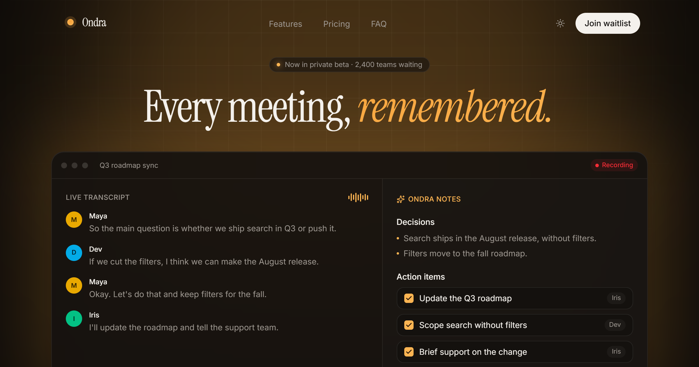
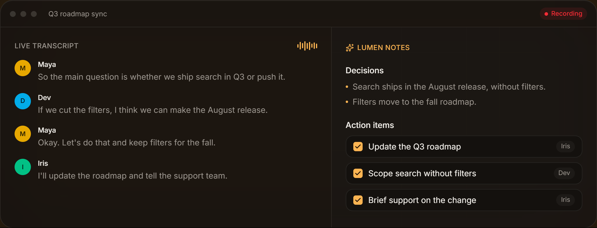
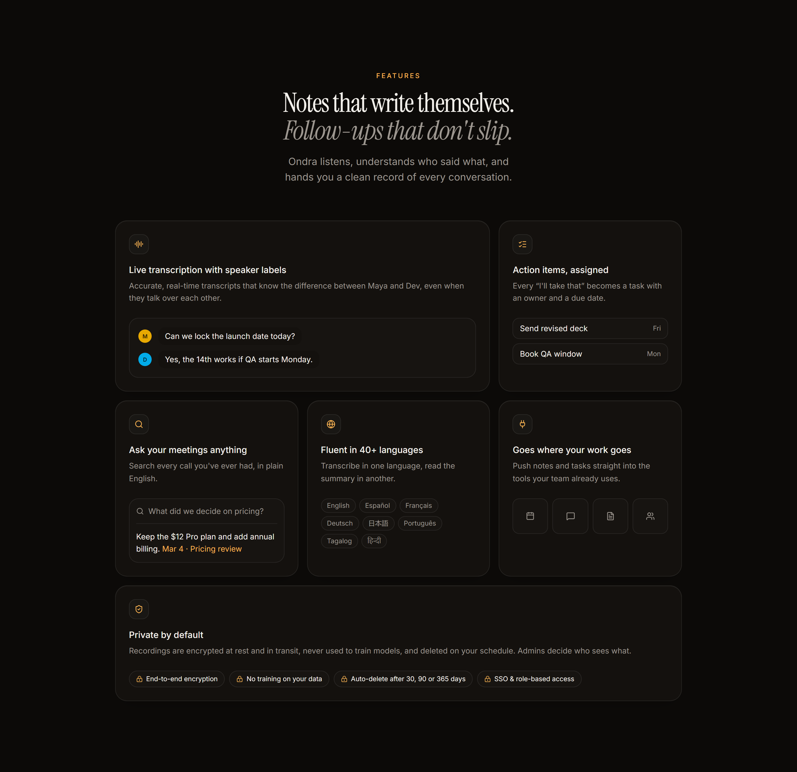
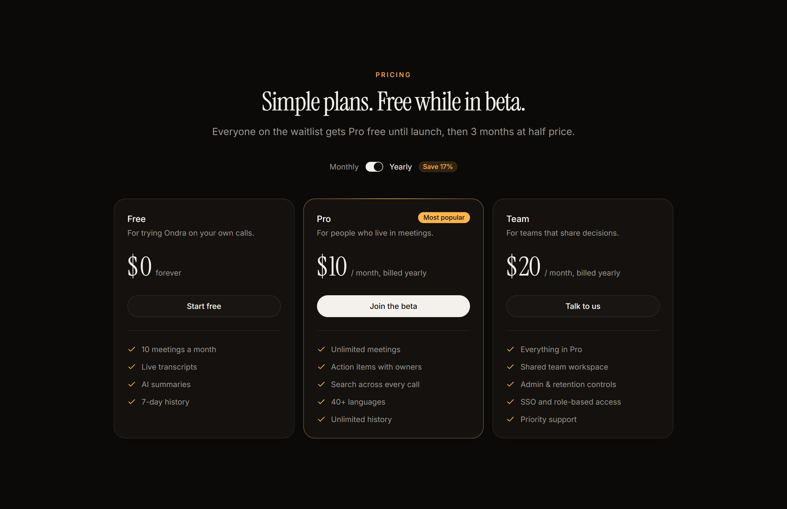
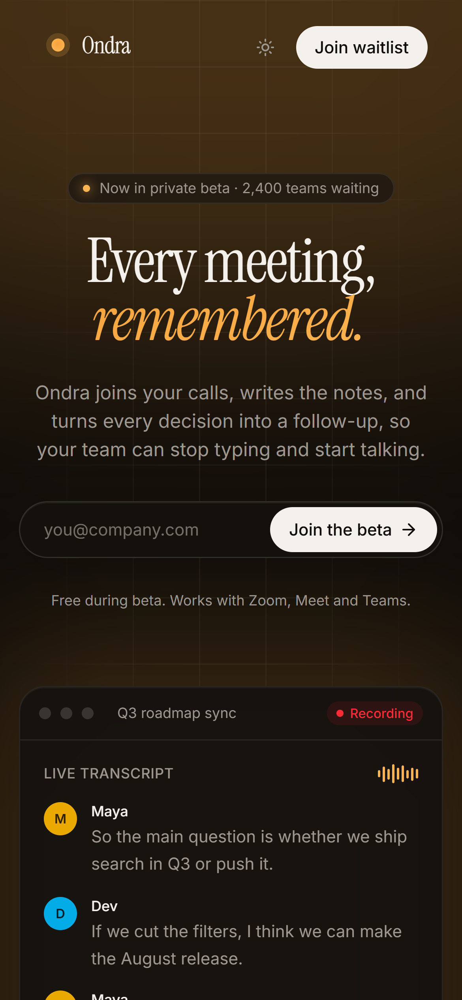
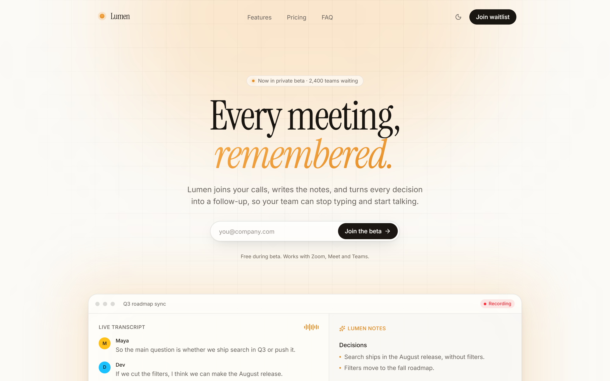

# Ondra: case study

**Role:** Design and development (solo)
**Type:** SaaS marketing site / landing page
**Stack:** Next.js 16, TypeScript, Tailwind CSS v4, shadcn/ui, Motion, Supabase, Resend, Vercel
**Links:** [Live site](https://ondra-saas-landing.vercel.app) · [Code](https://github.com/shervs336/ondra-saas-landing)

---

## Short version (for a portfolio card)

> A premium landing page for a fictional AI meeting-notes startup. It has an animated product demo, dark and light themes, and a real waitlist that saves to Postgres and sends a confirmation email. Lighthouse scores 100 on desktop across the board.

---

## Problem

Early-stage startups need a landing page that does two jobs: explain the product in seconds and collect interested users before launch. Most templates look generic, and a waitlist that only *pretends* to save signups is useless.

The goal was a page that feels like a funded product's site, with a waitlist that actually works, built and hosted entirely on free tiers.

## Approach

- **Show, don't tell.** Instead of a static screenshot, the hero shows the product working. A meeting transcript appears line by line, then Ondra writes the decisions and checks off action items. Visitors understand the product before they read a word.
- **Editorial typography.** A serif display face (Instrument Serif) paired with Inter, plus a warm amber accent, set it apart from the default "blue SaaS" look.
- **Real backend, zero cost.** The waitlist uses a Next.js Server Action that writes to Supabase Postgres and sends a confirmation email through Resend.

## Key decisions

| Decision | Why |
|---|---|
| Server Action instead of an API route | One function does validation, insert and email; the form gets pending, error and success states from `useActionState` with little client code. |
| Supabase row-level security with an insert-only policy | The public key can add emails but can never read the list, so a leaked key exposes nothing. |
| Honeypot field + server-side validation | Blocks basic bots without a CAPTCHA that would hurt conversions. |
| Demo mode when keys are missing | Anyone who clones the repo can run it immediately. |
| CSS-only hero animation, lazy-loaded Motion elsewhere | The headline paints without waiting for JavaScript, which helps first paint on slow phones. |
| Dark theme by default, light theme saved per visitor | The dark theme shows the glow and depth best; a tiny inline script applies the saved theme before paint, so there's no flash. |

## Details worth noticing

- The pricing toggle rolls the numbers instead of swapping them.
- The testimonials marquee pauses on hover and stops entirely for visitors who prefer reduced motion.
- Feature cards glow softly on hover, picking up the accent color.
- Every animation respects `prefers-reduced-motion`.

| Features | Pricing |
|---|---|
|  |  |

## Result

- Live at **ondra-saas-landing.vercel.app**, deployed from GitHub on every push.
- Waitlist verified end to end in production: signups are stored, duplicates are detected, and confirmation emails send.
- **Lighthouse:** Desktop 100 / 100 / 100 / 100. Mobile: Accessibility, Best Practices and SEO 100, Performance around 75–85 on a simulated slow phone.
- Fully responsive from 360px up, in both themes.

| Mobile | Light theme |
|---|---|
|  |  |

## What I'd do next

- Bring mobile performance closer to 100 by turning more sections into server-only components.
- Add a referral link to the waitlist ("move up the list by inviting friends").
- Add privacy-friendly analytics to measure the signup conversion rate.
